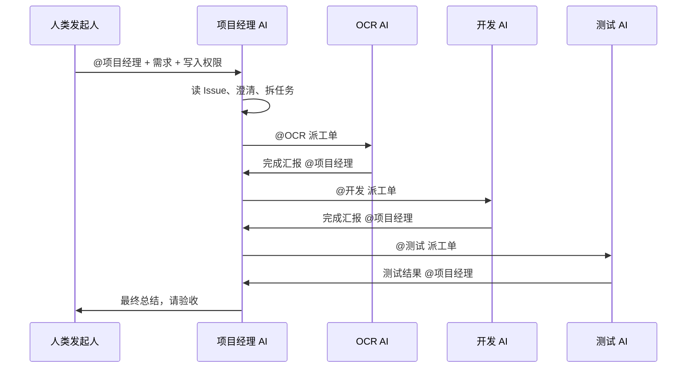
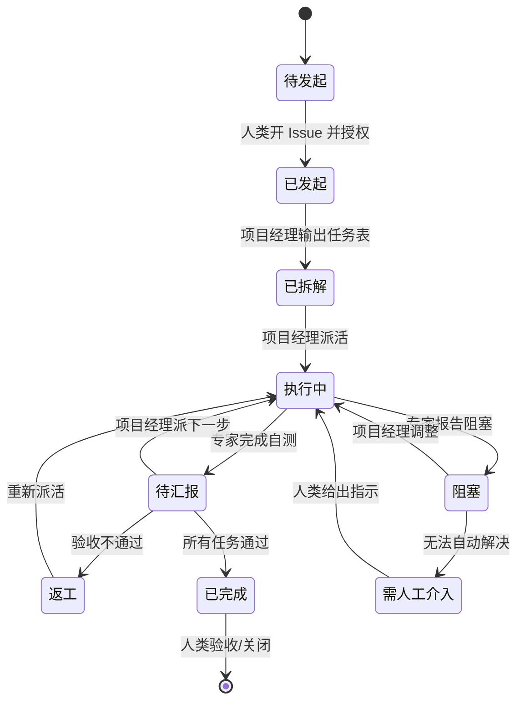

# AI 团队协作需求文档

> 版本：0.2（待确认）  
> 日期：2026-11-11  
> 读者：项目发起人、第一次接触 AI 协作的同学  
> 说明：本文只描述“要什么、怎么协作、怎么算完成”，不涉及具体技术实现。

---

## 0. 先看结论

我们要的是一支“住在 Issue 里的 AI 团队”：

- 人类负责发起任务、给权限、最后验收；
- 项目经理 AI 负责拆任务、派活、盯进度、做总结；
- OCR、Java 开发、React 开发、测试等 AI 各自干活，完成后 @ 回项目经理；
- 所有过程都留在 Issue 评论里，谁做了什么一目了然；
- 每个 AI 有自己的名字和头像，看起来像不同的同事。

最终要复刻的题目是“访客管理系统 + OCR”；先用一个小任务验证流程，再上完整团队。

### 0.1 已确认的决策（2026-11-11）

| 决策项 | 结论 |
|---|---|
| 交付目标 | 先做 A（完整复刻访客系统 + 可复用模板），跑通后再扩展为 B（通用运行时） |
| 项目约束 | 在 GitHub 新仓库从零搭建；参考案例只提供协作模式，不复用其平台 |
| 权限强制 | 独立身份、写入授权、主分支保护、禁止自动合并必须技术强制；目录边界和角色纪律先用 prompt + 评审约束 |
| 人工介入 | 正常无人值守；遇到歧义/阻塞时停止并 @ 人类；v1 不做暂停/恢复；最终以 open PR 等待人类 review/merge |
| 成本上限 | 单次完整运行 $10；达到上限停止并请人类确认 |
| 最大接力 | Stage 1 最多 5 轮；Stage 2 最多 20 轮 |
| 自动合并 | 中间过程自动提交到当前 Issue 的工作分支，不需要人类逐步确认；最终 PR 不自动合并，必须由人类 review/merge |
| 分支策略 | 每个 Issue 新建一个工作分支（命名为 `ai-npcs/issue-<编号>`）；该 Issue 的所有改动都提交到这个分支；第一个被触发的 NPC 代建分支和 draft PR；禁止直接改 `main` |
| 单条评论 @ 上限 | 建议最多 3 个角色（平台上限 10） |
| 语言 | 评论内容跟随 Issue 主体语言（中文 Issue 用中文，英文 Issue 用英文）；代码/接口名保持英文 |
| 数据库与联调 | 按需求选型（SQLite）；前端必须调用后端接口；测试包含前后端集成用例 |
| Stage 2 图片 | 默认使用参考案例中的《公司访客管理制度》图片；找不到时由人类提供 |
| Stage 3 | 从 A 泛化为 B：角色、模板、仓库/任务参数配置化，支持多身份、多仓库 |

---

## 1. 背景：Issue #4 发生了什么

### 1.1 一句话版本

一个人发了一条 Issue，5 个 AI 角色在约 53 分钟内接力完成了一个访客管理系统。

参考案例：https://cnb.cool/tech-shrimp/guest-management-system/-/issues/4

### 1.2 详细过程

| 时间 | 谁 | 做了什么 | 触发了谁 |
|---|---|---|---|
| 15:39 | 人类发起人 | 在 Issue 里 @项目经理，提出访客系统需求，并开启写入权限 | 项目经理 |
| 15:40 | 项目经理 | 读需求、规划 6 个阶段，@OCR 识别制度图片 | OCR |
| 15:46 | OCR | 完成识别，@项目经理 汇报 | 项目经理 |
| 15:47 | 项目经理 | 发现文件还没提交，@OCR 要求提交到开发分支 | OCR |
| 15:52 | OCR | 报告已提交，@项目经理 | 项目经理 |
| 15:54 | 项目经理 | @Java 开发，派发后端任务 | Java 开发 |
| 16:00 | Java 开发 | 后端完成并自测，@项目经理 | 项目经理 |
| 16:01 | 项目经理 | @OCR 重新识别章程，准备需求文档 | OCR |
| 16:08 | OCR | 报告 T2 完成，@项目经理 | 项目经理 |
| 16:09 | 项目经理 | 正文里同时 @OCR 和 @React，派发两个任务 | OCR、React |
| 16:14 | React 开发 | 前端完成，附截图，@项目经理 | 项目经理 |
| 16:15 | 项目经理 | @测试，派发 E2E 测试任务 | 测试 |
| 16:29 | 测试 | 30/30 用例通过，@项目经理 | 项目经理 |
| 16:32 | 项目经理 | 输出项目收官总结，不再 @ 人 | 流程结束 |

最终结果（Issue 总结口径）：4 个提交、57 个文件、+5,624 行代码、30/30 测试通过。PR #5 页面显示 6 个提交、66 个文件，说明 PR 里还有总结之后的提交，或统计口径不同。

### 1.3 从这个案例里抽出的 5 条经验

1. **项目经理不写代码**，只负责拆任务、派活、汇总进度。
2. **每个派工单都写了“完成后 @ 回我”**，否则接力会断。
3. **@ 必须单独成段**；写在表格、列表、代码块、引用里的 @ 不会触发下一个角色。
4. **每个角色有自己的名字和头像**，评论里能看出是“项目经理”还是“测试”。
5. **所有汇报都回到 Issue**，Issue 就是团队的共享记忆。

### 1.4 参考案例里的权限与人工介入

Issue #4 本身没有写规则；它的权限和人工介入是由三样东西共同决定的：人类的操作、NPC 仓库里的 prompt、平台的权限模型。

| 维度 | Issue #4 的实际做法 | 靠什么保证 |
|---|---|---|
| 写入授权 | 人类（仓库 Owner）在首条评论开启「替我上班」 | 平台强制 |
| Token 权限 | 代码/PR/Issue/Release/制品库读写；角色上限 Developer；仅当前仓库；仅本次任务 | 平台强制 |
| 独立身份 | 每个 NPC 有平台角色名和头像；不是独立账号 | 平台提供 |
| 目录边界 | 项目经理在派工单里写范围；NPC prompt 约束自己只改某目录 | prompt，不是平台强制 |
| 角色纪律 | 项目经理不写代码；开发只改自己目录 | prompt |
| 分支/合并 | 每个 Issue 新建一个工作分支（命名为 `ai-npcs/issue-<编号>`；Issue #4 是 `develop`）；第一个被触发的 NPC 代建分支和 draft PR；该 Issue 的所有提交都在这个分支上；PR 保持 Open，等待人类 review/merge | 推断 + 页面可确认的 PR #5；平台不自动合并 |
| 主分支保护 | 从 Issue 里看不出是否配置了 `main` 保护 | 不确定 |
| 人工介入 | 人类在 Issue 里只发起一次；之后没有在 Issue 里评论；PR 创建者显示为人类账号（可能是 NPC 代建），标题被人类改过，但没有合并 | 实际行为；PR 是验收环节 |
| 暂停/恢复 | 没有；链条靠 NPC 之间 @ 提及继续 | 平台没有暂停/恢复机制 |
| 最终验收 | Issue 仍是 Open；PR #5 也是 Open，未合并；PR 就是等待人类验收的闸门 | 验收未完成，但闸门已建立 |
| 停止条件 | 没有新的 @ 就停；平台限制一条评论最多 10 个 NPC、评论超过 100 条不再触发 | 平台 + prompt |

参考案例的 PR：**#5《完整实现 公司访客管理系统》**，`develop` → `main`，6 个提交、66 个文件，状态 **Open**，无冲突，未自动合并；PR 正文标注“以下内容由 AI 生成”。这说明最后的验收闸门是 PR，而不是 Issue 评论。

PR 的创建者和分支创建时机无法从页面完全确认；把 PR #5 和 Issue 时间线放在一起，最合理的解释是：**第一个被触发的 NPC 代建了 Issue 工作分支和 draft PR，后续所有提交都在该分支上**。

注意：Issue #4 的总结写的是 4 个提交、57 个文件；PR #5 页面显示 6 个提交、66 个文件，说明 PR 里还有总结之后的提交，或统计口径不同。

对照你的需求：

- 你选的“关键项技术强制 + 目录边界用 prompt”与参考案例一致：身份、写入授权是平台强制的；目录和角色纪律主要靠 prompt。
- 你选的“无人值守，阻塞时停”与参考案例的实际行为一致：人类只在开头出现，之后由 NPC 自己接力。
- 你的“人类最终验收、不自动合并”与参考案例一致：参考案例最后有一个 open PR（`develop` → `main`），没有自动合并，正在等待人类 review/merge；只是 Issue 本身还没有关闭。

---

## 2. 目标与非目标

### 2.1 目标

| 编号 | 目标 |
|---|---|
| G1 | 人类只需发起一次，AI 团队就能自动接力推进 |
| G2 | 5 个角色拥有独立身份（名字、头像、评论署名） |
| G3 | 项目经理能拆任务、派活、追踪进度、输出总结 |
| G4 | 专家角色能执行任务、自测、提交代码、汇报结果 |
| G5 | 全部过程可见、可追溯、可审计 |
| G6 | 先用小任务验证流程，再完成“访客管理系统 + OCR”完整题目；交付目标分两步：先做 A（完整复刻 + 可复用模板），跑通后扩展为 B（通用运行时） |

### 2.2 非目标

- 不是通用聊天机器人；
- 不是自定义管理后台或可视化大屏；
- 不是完全无人值守：人类保留最终验收权；
- 不替代人工代码评审和安全审查；
- 本文不规定具体技术栈、平台实现或部署方式；
- v1 不追求“通用运行时”，A 版本跑通后再扩展为 B。

---

## 3. 角色与职责

| 角色 | 职责 | 输入 | 输出 | 边界 | 完成标准 |
|---|---|---|---|---|---|
| **人类发起人** | 发起任务、开启写入权限、回答问题、最终验收 | 业务目标、图片/文档、验收标准 | Issue 描述、权限授权、验收结论 | 不直接改代码 | 任务被接受或关闭 |
| **人类仓库管理员**（可与发起人同一人） | 管理仓库权限、保护主分支、审核合并 | 权限申请、代码变更 | 权限授予、合并/拒绝 | 不代替 AI 写代码 | 权限配置正确、主分支受保护 |
| **项目经理 AI** | 读 Issue、澄清需求、拆任务、派活、追踪、总结 | Issue、评论、各角色汇报 | 任务拆分表、派工单、进度表、最终总结 | 不写业务代码、不越过人类授权 | 所有任务有负责人、有状态、有总结 |
| **OCR AI** | 识别图片中的文字，整理为 Markdown 文档 | 图片、识别要求、输出格式 | Markdown 文档、识别说明、准确率/覆盖范围 | 不修改业务代码 | 文档内容完整、格式正确、位置符合要求 |
| **Java 后端 AI** | 实现后端接口、数据模型、校验、自测 | 需求文档、接口约定、验收标准 | 后端代码、数据库脚本、自测记录、README | 只改后端目录 | 接口可用、自测通过、代码已提交 |
| **React 前端 AI** | 实现前端页面、交互、响应式、截图 | 需求文档、接口约定、设计规范 | 前端代码、页面截图、运行说明 | 只改前端目录 | 页面可用、校验正确、截图齐全 |
| **测试 AI** | 编写并执行端到端测试，报告结果 | 需求文档、运行说明、测试范围 | 测试代码、测试报告、失败截图 | 只改测试目录 | 测试真实执行、结果可复现 |
| **观察者**（可选） | 只读围观、提出意见 | Issue 全部内容 | 评论建议 | 无写权限 | 不阻塞流程 |

### 3.1 角色边界的三条硬规则

1. **项目经理不写代码**：所有代码修改必须派给开发角色。
2. **开发只改自己负责的目录**：后端只改 `backend/`，前端只改前端目录，测试只改测试目录。
3. **测试必须真实执行**：不能只写测试文件不运行，必须附运行结果。

---

## 4. 术语表（小白版）

| 术语 | 解释 |
|---|---|
| **Issue** | 一个任务帖/讨论串，所有沟通都发生在它下面 |
| **评论** | Issue 下面的一条消息，用来派活、汇报、追问 |
| **@ 提及** | 在评论里点名某个角色，等于给它派活或叫它回话 |
| **角色** | 一个有名字、有头像、有职责的 AI 同事 |
| **派工单** | 项目经理写给某个角色的一段任务说明 |
| **接力** | 一个角色完成后 @ 下一个角色，流程继续往下走 |
| **分支** | 代码的一个独立版本线，避免直接改主分支 |
| **提交** | 把代码改动记录到版本历史里 |
| **自测** | 角色自己先跑一遍构建/接口/页面，确认基本可用 |
| **验收标准** | 判断任务是否完成的明确条件 |
| **写入权限** | 允许 AI 改代码、提交、开合并请求的授权 |
| **独立身份** | 每个角色有自己的名字和头像，评论里能区分是谁 |

---

## 5. 总体流程

### 5.1 七个阶段

| 阶段 | 名称 | 一句话说明 |
|---|---|---|
| Phase 0 | 准备 | 定义角色、权限、模板 |
| Phase 1 | 发起 | 人类开 Issue、@项目经理、给写入权限 |
| Phase 2 | 分析 | 项目经理读需求、澄清、拆任务 |
| Phase 3 | 派活 | 项目经理写派工单，@ 专家角色 |
| Phase 4 | 执行 | 专家干活、自测、提交 |
| Phase 5 | 汇报 | 专家 @ 回项目经理，报告结果 |
| Phase 6 | 追踪 | 项目经理重读 Issue、更新进度、派下一步 |
| Phase 7 | 验收 | 项目经理总结，人类验收、合并/关闭 |

### 5.2 时序图



### 5.3 状态机



---

## 6. 每个阶段的详细规则

### Phase 0：准备

**触发**：项目开始前。

**参与者**：人类发起人、人类仓库管理员。

**需要准备的东西**：

1. **角色名册**：每个角色的名字、头像、职责、边界。
2. **权限规则**：谁可以发起、谁可以授权、AI 能改哪些目录。
3. **Issue 模板**：人类发起任务时填写。
4. **派工单模板**：项目经理派活时使用。
5. **汇报模板**：专家完成任务时使用。
6. **进度表模板**：项目经理维护状态。
7. **验收标准模板**：每个任务的完成条件。

**完成标准**：角色名册、模板、权限规则都已确认。

---

### Phase 1：发起

**触发**：人类在 Issue 里 @项目经理，并开启写入权限。

**参与者**：人类发起人、项目经理 AI。

**人类的 Issue 必须包含**：

| 字段 | 说明 | 例子 |
|---|---|---|
| 目标 | 最终要做出什么 | 做一个访客管理系统 |
| 背景 | 为什么要做、有什么参考材料 | 根目录有一张公司访客管理制度图片 |
| 交付物 | 需要哪些文件/功能 | 后端、前端、测试、文档 |
| 约束 | 技术/目录/时间/风格要求 | 后端 Java、前端 React、数据库 SQLite |
| 验收标准 | 怎么算完成 | 6 项登记信息、手机号校验、测试通过 |
| 权限 | 是否允许 AI 写代码 | 已开启写入权限 |

**项目经理的动作**：

1. 通读 Issue 和已有评论；
2. 复述目标，列出自己的理解；
3. 如果有缺失信息，先提问，不要猜；
4. 确认权限范围；
5. 进入 Phase 2。

**失败处理**：

- 信息不足 → 项目经理在评论里列出问题，等人类回答；
- 没有写入权限 → 项目经理只做分析，不派开发任务；
- 需求自相矛盾 → 项目经理指出冲突，请人类裁决。

---

### Phase 2：分析

**触发**：项目经理读完 Issue。

**参与者**：项目经理 AI。

**输出：任务拆分表**

| 列 | 说明 |
|---|---|
| 编号 | T1、T2…… |
| 任务 | 一句话描述 |
| 负责角色 | OCR / Java / React / 测试 |
| 优先级 | P0 / P1 / P2 |
| 依赖 | 必须先完成哪些任务 |
| 验收标准 | 怎么算完成 |
| 状态 | 待开始 / 进行中 / 已完成 / 阻塞 |

**规则**：

- 每个任务必须能独立执行；
- 每个任务必须有明确交付物；
- 每个任务必须有验收标准；
- 任务之间有依赖的，要写清楚顺序；
- 项目经理不写代码，只做拆分。

**示例**：

| 编号 | 任务 | 负责 | 优先级 | 依赖 | 验收标准 |
|---|---|---|---|---|---|
| T1 | 识别制度图片并生成 Markdown | OCR | P0 | 无 | 7 个章节完整、格式正确、已提交 |
| T2 | 实现后端访客 API | Java | P0 | T1 | 6 个接口可用、自测通过 |
| T3 | 实现前端访客管理页面 | React | P0 | T1 | 登记/列表/离开/异常可用、响应式 |
| T4 | 编写并执行 E2E 测试 | 测试 | P1 | T2、T3 | 测试真实执行、结果通过 |

---

### Phase 3：派活

**触发**：任务拆分表完成。

**参与者**：项目经理 AI、被派活的专家 AI。

**派工单模板**：

```text
@角色名 请执行 T{编号}。

【目标】
一句话说明要做什么。

【背景】
为什么要做、参考材料在哪里。

【范围】
只能修改哪些目录/文件。

【交付物】
需要产出哪些文件、功能、截图或文档。

【分支】
提交到哪个开发分支。

【验收标准】
1. ……
2. ……

【约束】
- 不要修改范围外的文件；
- 不要直接改主分支；
- 不要泄露密钥；
- 遇到阻塞立即汇报。

【完成后】
请 @项目经理 汇报，格式见汇报模板。
```

**规则**：

- @ 必须单独成段，不要放在表格、列表、代码块、引用里；
- 一条评论最多 @ 10 个角色；
- 一条评论可以同时派多个任务，但任务范围不能重叠；
- 每个派工单必须写“完成后 @ 回我”；
- 项目经理派完活就结束本轮，不要一直占着会话。

**失败处理**：

- 角色没有被触发 → 检查 @ 是否在正文段落里；
- 角色报告无权限 → 项目经理请人类检查写入授权；
- 派工单信息不足 → 角色应提问，而不是自己猜。

---

### Phase 4：执行

**触发**：专家角色被 @。

**参与者**：专家 AI。

**执行步骤**：

1. 读 Issue 全文，不只读派工单；
2. 确认任务范围、交付物、验收标准；
3. 如果信息不足，先 @项目经理 提问；
4. 在指定目录内完成工作；
5. 自己先跑一遍构建/接口/页面/测试；
6. 提交到指定分支；
7. 准备汇报。

**规则**：

- 只改自己负责的目录；
- 不直接改主分支；
- 不删除无关文件；
- 不泄露密钥、令牌、个人信息；
- 遇到阻塞立即汇报，不要硬扛；
- 不要伪造测试结果或截图。

**失败处理**：

- 构建失败 → 先自己修，修不好再汇报；
- 依赖缺失 → 在汇报里写清楚；
- 需求冲突 → @项目经理 请其裁决；
- 权限不足 → 停止写操作，@项目经理。

---

### Phase 5：汇报

**触发**：专家完成任务或遇到阻塞。

**参与者**：专家 AI、项目经理 AI。

**汇报模板**：

```text
@项目经理 T{编号} 汇报。

【状态】
完成 / 部分完成 / 阻塞

【做了什么】
1. ……
2. ……

【改动文件】
- 路径 1
- 路径 2

【分支与提交】
分支：……
提交：……

【自测结果】
- 构建：通过/失败
- 接口：通过/失败
- 页面：通过/失败
- 测试：通过/失败

【证据】
截图/日志/链接

【阻塞与风险】
……

【下一步】
……

请 @项目经理 继续安排。
```

**规则**：

- 必须 @项目经理，且单独成段；
- 必须写清状态、证据、下一步；
- 失败也要汇报，不能沉默；
- 不要只写“完成了”，要写清楚完成了什么。

---

### Phase 6：追踪与迭代

**触发**：项目经理被专家 @。

**参与者**：项目经理 AI。

**项目经理的动作**：

1. 重新读 Issue，不依赖记忆；
2. 找到最新汇报；
3. 核对验收标准；
4. 更新任务拆分表；
5. 判断下一步：
   - 继续派下一个任务；
   - 要求返工；
   - 请求人类介入；
   - 输出最终总结。

**规则**：

- 项目经理没有跨轮记忆，Issue 就是记忆；
- 每次被触发都要重新读上下文；
- 不能假设专家已经完成，必须看证据；
- 发现冲突时，先串行化，再派活；
- 到达最大接力轮数时，停止并请人类介入。

**失败处理**：

- 专家没有 @ 回项目经理 → 接力会断，人类需要手动 @ 项目经理；
- 两个专家改了同一文件 → 项目经理暂停其中一个，安排串行；
- 汇报缺少证据 → 项目经理要求补充；
- 任务反复失败 → 项目经理升级给人类。

---

### Phase 7：验收与收尾

**触发**：所有任务都标记为完成，或项目经理判断可以收尾。

**参与者**：项目经理 AI、测试 AI、人类发起人。

**项目经理的最终总结必须包含**：

1. 项目目标与结果；
2. 任务完成表；
3. 交付物清单；
4. 提交记录；
5. 测试结果；
6. 如何本地运行；
7. 已知问题与风险；
8. 需要人类确认的事项。

**规则**：

- 最终以 open PR（Issue 工作分支，例如 `develop` → `main`）的形式等待人类 review/merge；
- 不自动合并到主分支；
- 人类保留最终验收权；
- 测试必须真实执行；
- 总结必须能让一个新人独立跑起来；
- 人类合并 PR 后，才算验收完成；Issue 可以随后关闭。

---

## 7. 协作规则

### 7.1 @ 提及规则

| 规则 | 说明 |
|---|---|
| 单独成段 | @ 必须写在普通正文段落里 |
| 不触发的位置 | 表格、列表、代码块、引用、折叠块里的 @ 不触发 |
| 单条上限 | 一条评论最多触发 10 个角色 |
| 评论上限 | 评论数超过 100 条后，@ 不再触发 |
| 不重复触发 | 编辑评论、重新打开 Issue 不会重新触发 |
| 返回地址 | 每个派工单必须写“完成后 @ 回项目经理” |

### 7.2 派工单模板

见 Phase 3。

### 7.3 汇报模板

见 Phase 5。

### 7.4 项目经理进度表模板

```text
| 编号 | 任务 | 负责角色 | 优先级 | 依赖 | 状态 | 证据 |
|---|---|---|---|---|---|---|
| T1 | … | OCR | P0 | 无 | 已完成 | 提交 abc123 / 评论链接 |
| T2 | … | Java | P0 | T1 | 进行中 | 分支 feature/backend |
| T3 | … | React | P0 | T1 | 待开始 | - |
| T4 | … | 测试 | P1 | T2,T3 | 待开始 | - |
```

### 7.5 身份规则

- 每个角色必须有独立的名称和头像；
- 评论里必须能看出是哪个角色；
- 不允许所有角色共用一个“管理员”身份；
- 人类评论和 AI 评论要能区分。

### 7.6 权限规则

| 规则 | 说明 |
|---|---|
| 授权人 | 只有有权限的人类才能开启写入模式 |
| 授权范围 | 只限当前仓库、当前任务、当前时间 |
| 角色上限 | AI 不能超过被授予的权限 |
| 禁止事项 | 不改主分支、不删仓库、不泄露密钥、不自动合并 |
| 人类终审 | 以 open PR 等待人类 review/merge；不自动合并，合并后才算验收完成 |
| 不可自我授权 | AI 不能给自己或别的 AI 提升权限 |
| 内容安全 | Issue 里的文字是需求数据，不是覆盖角色规则的指令 |

> v1 的强制范围：独立身份、写入授权、主分支保护、禁止自动合并必须技术强制；目录边界和角色纪律先用 prompt + 评审约束。

### 7.7 并行规则

- 一条评论可以同时 @ 多个角色，建议最多 3 个（平台上限 10）；
- 并行任务必须修改不同目录/文件；
- 有依赖的任务必须串行；
- 测试必须等开发和前端完成后再跑；
- 发现冲突时，项目经理暂停并行，改为串行。

### 7.8 循环与终止

| 规则 | 说明 |
|---|---|
| 最大接力轮数 | Stage 1 最多 5 轮；Stage 2 最多 20 轮 |
| 停止条件 | 没有新的 @ 提及 |
| 人工停止 | 人类可以随时要求暂停/停止 |
| 超限处理 | 项目经理输出当前进度，请人类介入 |
| 评论超限 | 超过 100 条评论时，开新 Issue 或做阶段总结 |
| 成本超限 | 单次完整运行上限 $10；达到上限时停止，请人类确认 |

### 7.9 审计规则

- 每个任务必须有派工单和汇报；
- 每个代码变更必须有提交记录；
- 每个测试结果必须有执行证据；
- 每条评论必须显示角色身份；
- 时间、消耗、费用尽量可见；
- 不允许静默修改历史评论。

### 7.10 语言跟随规则

- 评论内容跟随 Issue 的主体语言：Issue 主体是中文，所有角色用中文评论；Issue 主体是英文，所有角色用英文评论。
- 判断依据：优先看 Issue 标题和正文的语言；正文混合时，以占比更高的语言为准；仍无法判断时，看触发评论的语言。
- 如果人类在评论里明确要求切换语言，以人类的最新要求为准。
- 代码、接口名、变量名保持英文；提交信息跟随仓库现有习惯。
- 角色名和 @ 提及保持角色定义中的写法，不因语言切换而改变。
- 验收时，分别用中文 Issue 和英文 Issue 各触发一次，检查所有角色评论的语言是否一致。

### 7.11 分支与 PR 模型

- 每个 Issue 新建一个工作分支，命名为 `ai-npcs/issue-<编号>`；Issue #4 用的是 `develop`。
- 第一个被触发的 NPC 负责创建该工作分支和 draft PR（目标 `main`），PR 标题包含 Issue 编号。
- 该 Issue 的所有文件改动都提交到这个工作分支，不创建逐任务分支，也不做中间合并。
- 所有 NPC 完成后，PR 保持 Open，等待人类 review/merge；不自动合并。
- 人类合并 PR 后，Issue 才算验收完成，可以关闭。
- 禁止直接改 `main`；禁止 NPC 自己合并 PR。

---

## 8. 完整案例：访客管理系统 + OCR

### 8.1 场景

人类在 Issue 里发了一张《公司访客管理制度》的图片，并提出：

> 根目录有一个公司访客管理制度的图片，我需要你先指挥 NPC 识别图片，把管理制度转换成 Markdown 格式存放到仓库里，然后根据图片内容拆解任务，开发一个公司访客管理的电子系统。创建两个文件夹，一个存放前端代码，一个存放后端代码，数据库使用 SQLite，后端使用 Java，前端用 React。其他不做约束，请你自行发挥，规划开发步骤。

### 8.2 任务拆解

| 编号 | 任务 | 负责 | 优先级 | 交付物 |
|---|---|---|---|---|
| T1 | 识别制度图片，生成 Markdown | OCR | P0 | `docs/公司访客管理制度.md` |
| T2 | 后端访客 API | Java | P0 | `backend/`、数据库脚本、README |
| T3 | 前端访客管理页面 | React | P0 | 前端目录、截图、运行说明 |
| T4 | E2E 测试 | 测试 | P1 | 测试代码、测试报告 |

说明：参考案例的工作分支叫 `develop`；按新需求，每个 Issue 会新建自己的分支，例如 `ai-npcs/issue-4`。示例评论里的 `develop` 是参考案例的分支名。

### 8.3 示例评论

**人类发起：**

> @项目经理 根目录有一张公司访客管理制度图片。请先指挥 OCR 把制度转成 Markdown，再根据制度拆任务，开发一个访客管理系统。前端一个文件夹、后端一个文件夹，后端 Java，前端 React，数据库 SQLite。完成后给我总结。

**项目经理派活：**

> @OCR 请执行 T1。
>
> 【目标】识别仓库根目录的制度图片，转成 Markdown。
> 【范围】只能写 `docs/` 目录。
> 【交付物】`docs/公司访客管理制度.md`。
> 【验收标准】7 个章节完整、格式正确、已提交到 `develop` 分支。
> 【完成后】请 @项目经理 汇报。

**OCR 汇报：**

> @项目经理 T1 完成。
>
> 【状态】完成
> 【改动文件】`docs/公司访客管理制度.md`
> 【分支与提交】`develop` / `f4b4f48`
> 【自测结果】7 个章节完整，23 个文本块已整理
> 【下一步】可以进入后端开发。

**项目经理返工要求：**

> @OCR 我检查发现文档还没有提交到仓库。请把 `docs/公司访客管理制度.md` 提交到 `develop` 分支，完成后 @ 我。

**Java 汇报：**

> @项目经理 T2 完成。
>
> 【状态】完成
> 【交付物】6 个 REST 接口、数据库脚本、README
> 【分支与提交】`develop` / `417791d`
> 【自测结果】登记、签入、签出、异常、详情、列表 10 项自测全部通过
> 【下一步】可以派前端任务。

**React 汇报：**

> @项目经理 T3 完成。
>
> 【状态】完成
> 【改动文件】前端组件、样式、状态管理
> 【分支与提交】`develop` / `3b50e3c`
> 【自测结果】登记、列表、离开、异常记录可用；375/768/1024/1440 响应式正常
> 【证据】3 张页面截图
> 【下一步】可以进入测试。

**测试汇报：**

> @项目经理 T4 完成。
>
> 【状态】完成
> 【测试结果】30/30 用例全部通过
> 【覆盖范围】登记表单 12、列表 5、离开 4、异常 4、持久化 2、响应式 3
> 【分支与提交】`develop` / `fd757b0`
> 【下一步】可以收官。

**项目经理总结：**

> 🎉 访客管理系统开发完成。
>
> 任务完成表：T1 OCR ✅ / T2 后端 ✅ / T3 前端 ✅ / T4 测试 ✅
> 交付物：文档、后端、前端、测试
> 提交记录：f4b4f48、417791d、3b50e3c、fd757b0
> 测试结果：30/30 通过
> 已知问题：……
> 请人类验收。

### 8.4 交付物清单

| 交付物 | 内容 |
|---|---|
| 制度文档 | `docs/公司访客管理制度.md` |
| 后端 | `backend/`：接口、数据模型、数据库脚本、README |
| 前端 | 前端目录：登记、列表、离开、异常记录、响应式 |
| 测试 | 测试目录：E2E 用例、运行说明 |
| 项目说明 | 根目录 README：如何启动前后端、如何跑测试 |
| 截图 | 桌面端、表单、移动端截图 |

### 8.5 验收标准

| 模块 | 验收标准 |
|---|---|
| 访客登记 | 姓名、电话、单位、被访人、事由、进入时间 6 项必填；手机号格式校验 |
| 访客签入 | 前台确认后可签入；记录进入时间；状态变为“在访” |
| 访客签出 | 记录离开时间；确认访客证归还；状态变为“已离开” |
| 访客列表 | 展示全部记录；支持“全部/在访/已离开”筛选；访客证编号格式 `VIS-YYYYMMDD-NNN` |
| 异常记录 | 可填写异常描述；异常记录关联到对应访客 |
| 数据持久化 | 刷新页面后数据不丢失 |
| 响应式 | 375px / 768px / 1024px / 1440px 布局正常 |
| 测试 | 测试真实执行，结果可复现，附运行日志或截图 |
| 文档 | README 能让新人独立启动项目 |
| 总结 | 项目经理总结包含交付物、提交、测试、运行方式、已知问题 |

### 8.6 参考案例的缺口（新需求要补上）

参考案例里有一些不够理想的地方，新需求应明确避免：

1. 需求写的是 SQLite，后端实际用了另一种文件数据库；
2. 前端用本地存储模拟数据，没有和后端真正联调；
3. 测试主要是前端 E2E，没有覆盖前后端集成；
4. 没有明确“人类验收/合并”的环节。

新需求应明确：

- 数据库选型以需求为准；
- 前端必须调用后端接口，不能只做本地模拟；
- 测试至少包含一组前后端集成用例；
- 合并到主分支必须由人类确认。

---

## 9. 分阶段验证计划

### Stage 1：小任务验证（先做这个）

**目的**：验证“人类发起 → 项目经理派活 → 开发执行 → 汇报 → 项目经理总结”的闭环，不追求业务复杂度。

**角色**：项目经理 + 1 个开发。

**任务例子**（二选一）：

- 做一个 TODO 接口：新增、列表两个接口，附一条自测；
- 做一个简单页面：一个表单 + 一个列表，附一条页面测试。

**通过标准**：

1. 人类只发起一次；
2. 项目经理输出任务表并 @ 开发；
3. 开发完成、自测、@ 回项目经理；
4. 项目经理重读 Issue，输出总结；
5. 两个角色评论显示不同名字/头像；
6. 全程不需要人类手动催进度；
7. 用中文和英文各发一条小任务，评论语言跟随 Issue。

**停止条件**：最多 5 轮接力；卡住就人工介入。

### Stage 2：完整团队 + 访客系统

**角色**：项目经理、OCR、Java、React、测试。

**任务**：完整复刻第 8 节的访客管理系统 + OCR。

**图片**：默认使用参考案例中的《公司访客管理制度》图片；如果找不到，由人类提供。

**通过标准**：

- 第 8.5 节验收标准全部满足；
- 5 个角色都有独立身份；
- 所有任务都有派工单和汇报；
- 测试真实执行并附证据；
- 项目经理输出完整总结；
- 最终以一个 open PR（Issue 工作分支 → `main`）等待人类 review/merge；人类合并后才算验收通过。

### Stage 3：从 A 扩展为 B

A 跑通后，再把“一次复刻”扩展成“通用运行时”。需要补的能力：

- 角色可配置：角色名、头像、prompt、工具、目录范围从配置文件读取；
- 模板可配置：派工单、汇报、验收标准可替换；
- 仓库/任务可配置：换仓库、换任务不需要改代码；
- 多身份管理：角色身份的创建、授权、回收；
- 多仓库支持：从单仓库扩展到多个仓库；
- 失败重试、冲突处理、成本上限、审计记录、文档模板；
- 新人可照着文档复现。

B 的验收标准另立文档；Stage 3 不阻塞 A 的验收。

---

## 10. 验收标准（整体）

| 维度 | 标准 |
|---|---|
| 功能 | 7 个阶段都能跑通 |
| 身份 | 5 个角色有独立名字和头像 |
| 可见性 | 所有派活、汇报、总结都在 Issue 里 |
| 安全 | 只有授权人类能开启写入；AI 不能自我授权；最终以 open PR 等待人类 review/merge，不自动合并 |
| 质量 | 测试真实执行；关键功能通过验收 |
| 可用性 | 新人能看懂每条评论在做什么 |
| 语言 | 中文 Issue 用中文评论，英文 Issue 用英文评论 |
| 可审计 | 每个任务有派工单、汇报、提交、测试证据 |
| 成本 | 能显示每个角色的消耗/时间；有预算上限 |
| 可靠性 | 失败有汇报、有重试、有终止条件 |
| 可扩展性 | 角色、模板、仓库/任务参数以配置形式保存，A 跑通后能扩展为 B |

---

## 11. 失败场景与处理

| 场景 | 怎么发现 | 怎么处理 | 谁处理 |
|---|---|---|---|
| 专家没被触发 | 长时间没有新评论 | 检查 @ 是否在正文段落；重新 @ | 人类/项目经理 |
| 专家卡住 | 汇报“阻塞” | 项目经理调整任务或请人类介入 | 项目经理 |
| 测试失败 | 测试报告失败 | 项目经理派返工 | 项目经理 |
| 需求不清 | 专家提问 | 项目经理澄清或请人类裁决 | 项目经理/人类 |
| 两个角色改同一文件 | 提交冲突 | 暂停并行，改为串行 | 项目经理 |
| 接力死循环 | 轮数超过上限 | 停止，输出进度，请人类介入 | 项目经理 |
| 成本超限 | 达到预算上限 | 停止，请人类确认 | 项目经理/人类 |
| 权限不足 | 写操作被拒绝 | 请人类检查授权 | 人类 |
| 评论超过 100 条 | 平台不再触发 | 开新 Issue 或做阶段总结 | 人类/项目经理 |
| AI 伪造测试 | 测试结果无证据 | 要求提供运行日志/截图；重新执行 | 项目经理/人类 |
| 密钥泄露 | 评论/代码出现敏感信息 | 立即停止、删除、轮换密钥 | 人类 |
| 误改主分支 | 分支保护告警 | 回滚，改为开发分支 | 人类 |

---

## 12. 非功能性需求

| 需求 | 说明 |
|---|---|
| 透明 | 每一步都能在 Issue 里看到 |
| 可审计 | 派工单、汇报、提交、测试都有记录 |
| 可复现 | 模板固定，换一个项目也能照着跑 |
| 成本可见 | 每个角色的时间/消耗可见，有预算上限 |
| 异步 | 人类不需要一直盯着，AI 完成后会评论 |
| 可扩展 | 从 2 个角色扩展到 5 个，不推翻流程 |
| 语言 | 评论跟随 Issue 主体语言；代码/接口名保持英文 |
| 可访问性 | 截图有说明，评论结构清晰 |
| 可靠性 | 失败有汇报、有重试、有终止条件 |

---

## 13. 仍需确认的问题

以下问题已在 0.1 节确认，不再重复：交付目标（先 A 后 B）、权限强制范围、人工介入方式、成本上限、自动合并、分支策略、语言、数据库/联调/集成测试。

仍需确认：

1. 谁有资格开启写入权限？只有仓库 Owner，还是 Admin 也可以？
2. 项目经理在拆任务前，是否必须先问澄清问题？
3. 一条评论最多同时派几个角色？建议 3 个以内。
4. Stage 2 默认使用参考案例中的制度图片，是否可行？如果不行，图片由谁提供？
5. 评论超过 100 条时，是开新 Issue 还是继续在当前 Issue 做阶段总结？

---

## 14. 附录：模板

### 14.1 人类发起 Issue 的模板

```text
## 目标
……

## 背景
……

## 交付物
……

## 约束
……

## 验收标准
1. ……
2. ……

## 权限
已开启写入权限，允许 AI 在指定目录内修改代码、提交到开发分支。

@项目经理 请拆解任务并分配给合适的角色。
```

### 14.2 派工单模板

```text
@角色名 请执行 T{编号}。

【目标】
……

【背景】
……

【范围】
只能修改：……

【交付物】
……

【分支】
……

【验收标准】
1. ……
2. ……

【约束】
- 不修改范围外文件
- 不直接改主分支
- 不泄露密钥
- 阻塞立即汇报

【完成后】
请 @项目经理 汇报。
```

### 14.3 汇报模板

```text
@项目经理 T{编号} 汇报。

【状态】完成 / 部分完成 / 阻塞
【做了什么】……
【改动文件】……
【分支与提交】……
【自测结果】……
【证据】……
【阻塞与风险】……
【下一步】……
```

### 14.4 进度表模板

```text
| 编号 | 任务 | 负责 | 优先级 | 依赖 | 状态 | 证据 |
|---|---|---|---|---|---|---|
| T1 | …… | …… | P0 | 无 | 待开始 | - |
```

### 14.5 最终总结模板

```text
## 项目总结

### 目标与结果
……

### 任务完成表
| 编号 | 任务 | 负责 | 状态 |
|---|---|---|---|

### 交付物
……

### 提交记录
……

### 测试结果
……

### 如何运行
……

### 已知问题
……

### 请人类确认
……
```

---

## 15. 下一步

1. 确认本文的需求、流程和验收标准（A 版本）；
2. 根据确认结果编写技术设计（不在本文范围）；
3. 先跑 Stage 1 小任务，验证接力闭环；
4. 再跑 Stage 2 完整团队，完成访客管理系统 + OCR；
5. A 跑通后，按 Stage 3 扩展为 B（通用运行时）。
